# Tavern Master in pictures

Tavern Master is a self-hosted AI Dungeon Master for a few friends: upload the
rules of your game, start a campaign, and play together in real time with a DM
that looks rules up, rolls real dice and keeps the party's state on the server.
The [README](README.md) covers what it does and how it is built; this page
shows it.

Every screenshot is the real app, running against a local server with a real
campaign, on an iPhone 15 Plus–sized screen (430 × 932) as an app installed to
the Home Screen. The client is built phone-first, so this is how it is meant
to be played.

## Getting in

Sign-up is by invite only. On an iPhone, the app walks you through adding it to
the Home Screen, where it opens full screen with no browser bars.

<table>
  <tr>
    <td align="center" width="33%">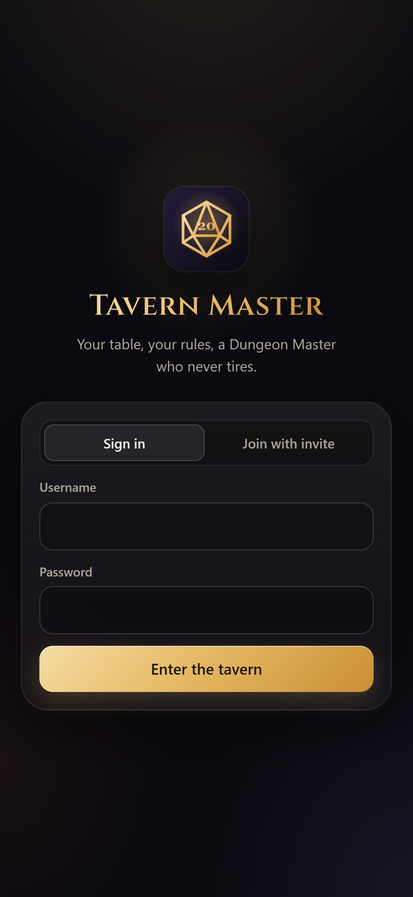</td>
    <td align="center" width="33%">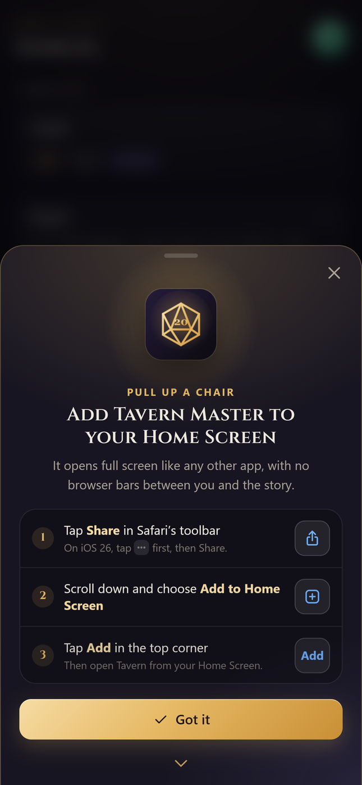</td>
    <td align="center" width="33%">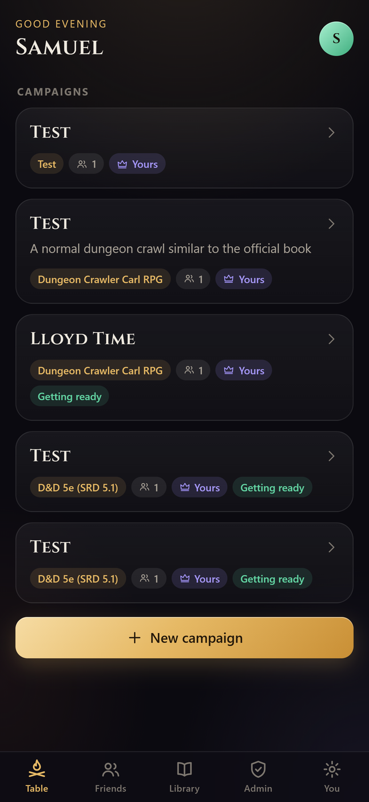</td>
  </tr>
  <tr>
    <td align="center"><b>Sign in</b> Invite-only accounts, argon2id and optional TOTP.</td>
    <td align="center"><b>Install</b> Step-by-step Add to Home Screen for iOS.</td>
    <td align="center"><b>Your table</b> Every campaign you are in, and its state.</td>
  </tr>
</table>

## Starting a campaign

A new campaign asks one big question first: who runs the game. The server's
own AI can, or the host's Claude can, on their own Claude plan with no API key.
The campaign then waits in a lobby while players build characters, either by
hand, from an uploaded sheet, or by talking it through with a character guide
that knows the rules and rolls real dice.

<table>
  <tr>
    <td align="center" width="33%">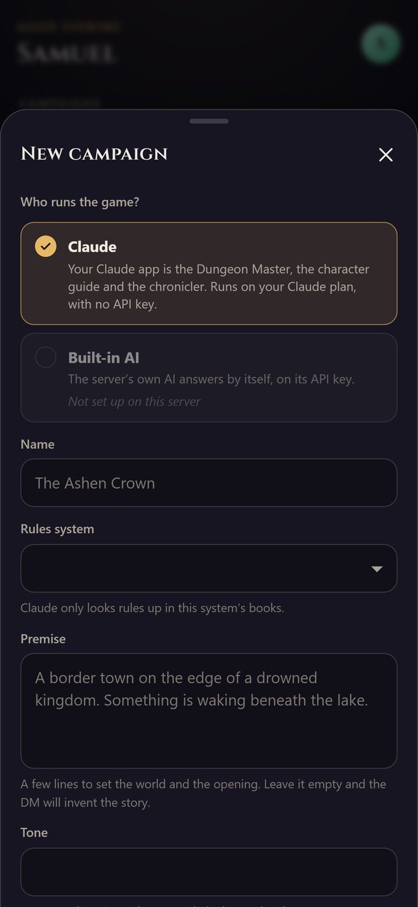</td>
    <td align="center" width="33%">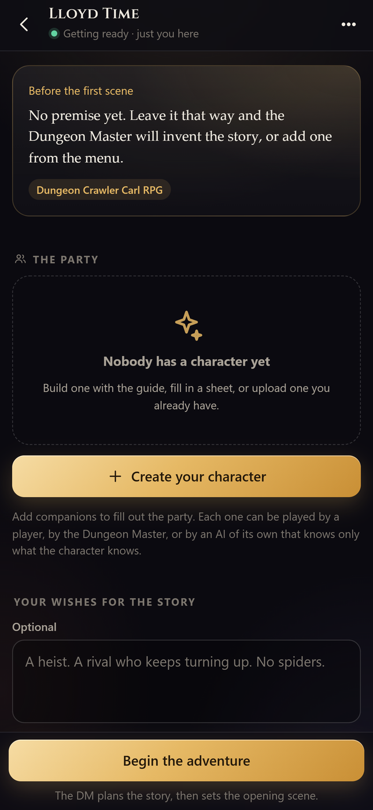</td>
    <td align="center" width="33%">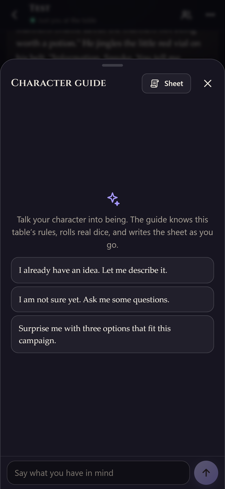</td>
  </tr>
  <tr>
    <td align="center"><b>Who runs the game?</b> Built-in AI or Claude, chosen per campaign.</td>
    <td align="center"><b>The lobby</b> Build the party and say what you want from the story.</td>
    <td align="center"><b>Character guide</b> Talk a character into being; it fills the sheet as you go.</td>
  </tr>
</table>

## At the table

Players act, an AI companion who knows only what its character has seen acts
after them, and the DM answers the whole turn at once. Every roll is made by
the server and shown with its dice, and names the DM introduces link into the
codex.

<table>
  <tr>
    <td align="center" width="50%">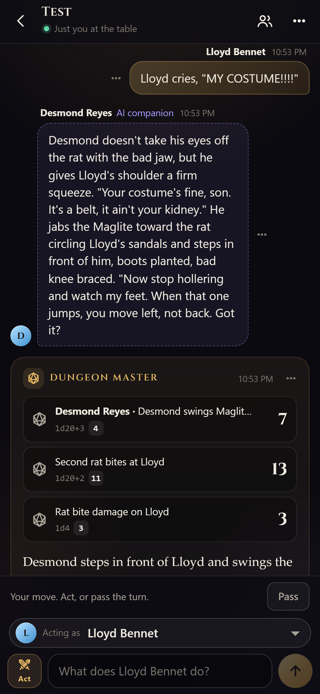</td>
    <td align="center" width="50%">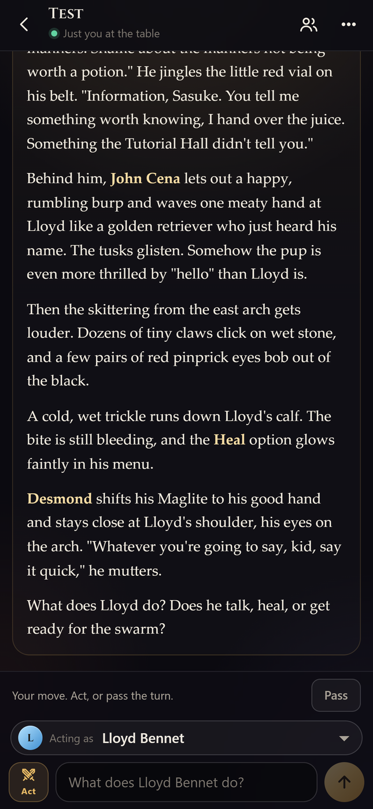</td>
  </tr>
  <tr>
    <td align="center"><b>A turn</b> Player, then companion, then the DM with real rolls.</td>
    <td align="center"><b>Narration</b> Codex links in the prose; Pass is always there.</td>
  </tr>
</table>

## The party and the world

Characters, NPCs, places and the scene live in structured state on the server,
not in the model's memory. Every change the DM makes is a validated write that
the players can see in the journal.

<table>
  <tr>
    <td align="center" width="25%">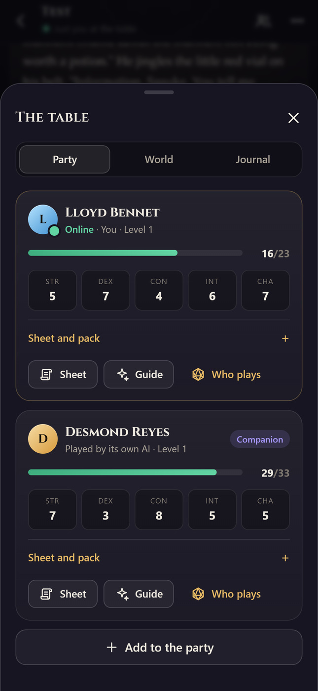</td>
    <td align="center" width="25%">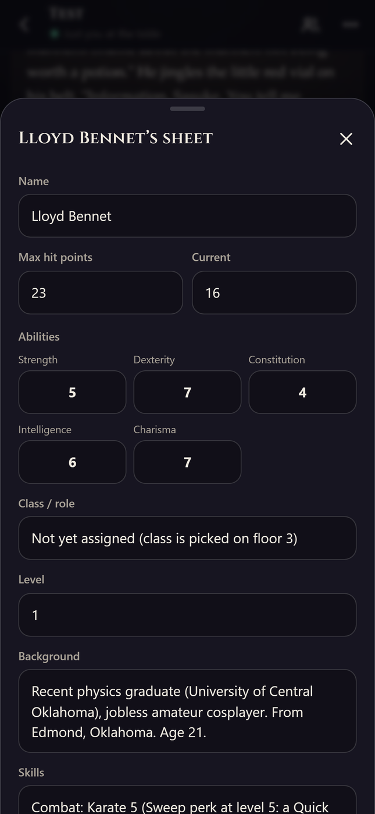</td>
    <td align="center" width="25%">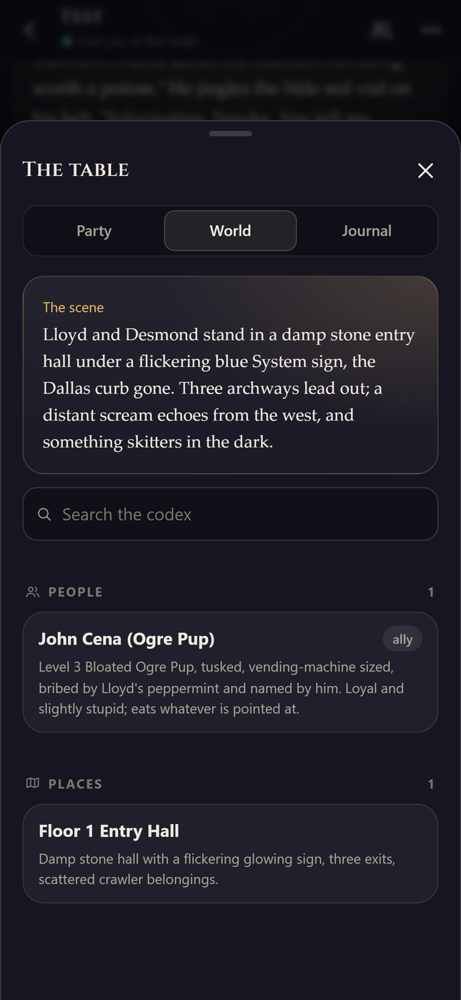</td>
    <td align="center" width="25%">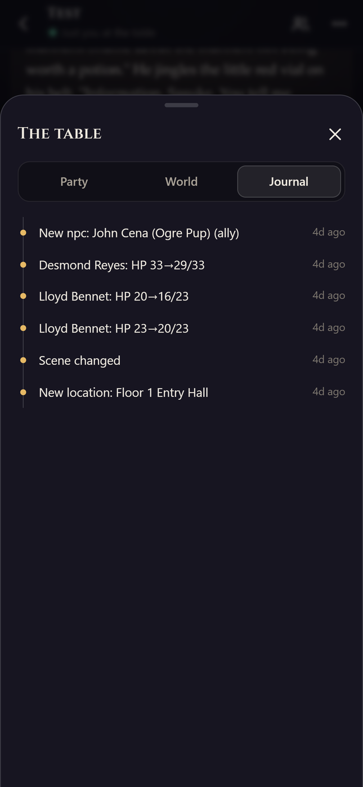</td>
  </tr>
  <tr>
    <td align="center"><b>Party</b> Hit points, abilities, controllers.</td>
    <td align="center"><b>Sheet</b> Drawn from the system's template.</td>
    <td align="center"><b>World</b> The scene and the codex.</td>
    <td align="center"><b>Journal</b> Every change the DM made.</td>
  </tr>
</table>

## Running things

The host manages the campaign from its menu. Admins build a rules library per
game system: the DM searches only the campaign's own system, and cites the
passage it used. And anyone can connect their Claude to the server as a
connector.

<table>
  <tr>
    <td align="center" width="25%">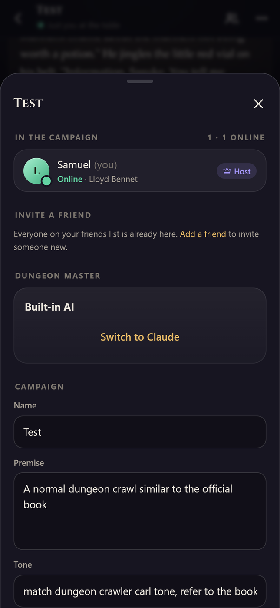</td>
    <td align="center" width="25%">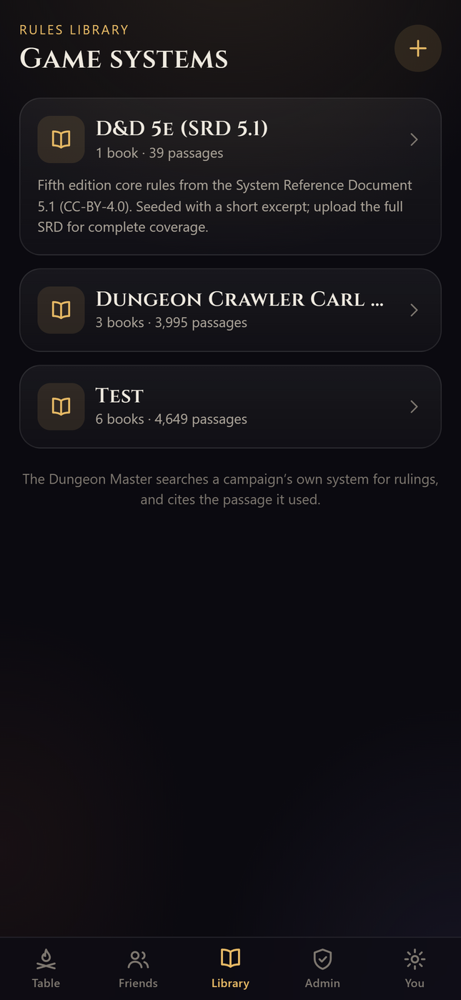</td>
    <td align="center" width="25%">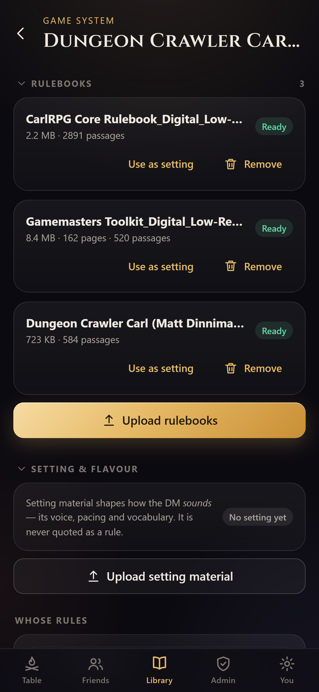</td>
    <td align="center" width="25%">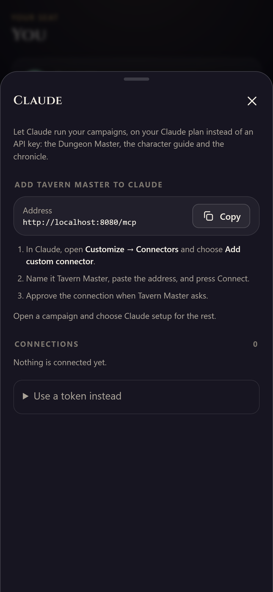</td>
  </tr>
  <tr>
    <td align="center"><b>Campaign menu</b> Members, the DM, the campaign.</td>
    <td align="center"><b>Rules library</b> One per game system.</td>
    <td align="center"><b>A game system</b> Rulebooks ingested on your hardware.</td>
    <td align="center"><b>Connect Claude</b> Paste one address into Claude.</td>
  </tr>
</table>

  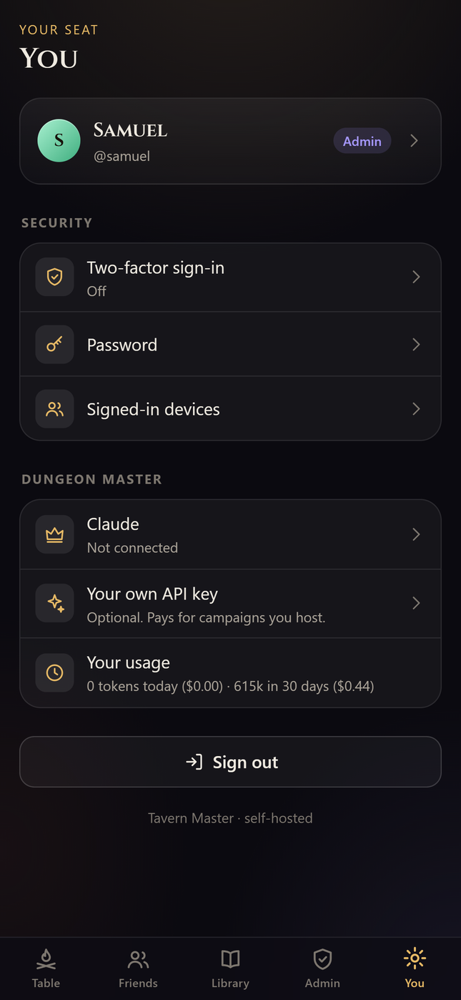 
  <b>You</b> Security, your own API key, and what your campaigns have cost.

